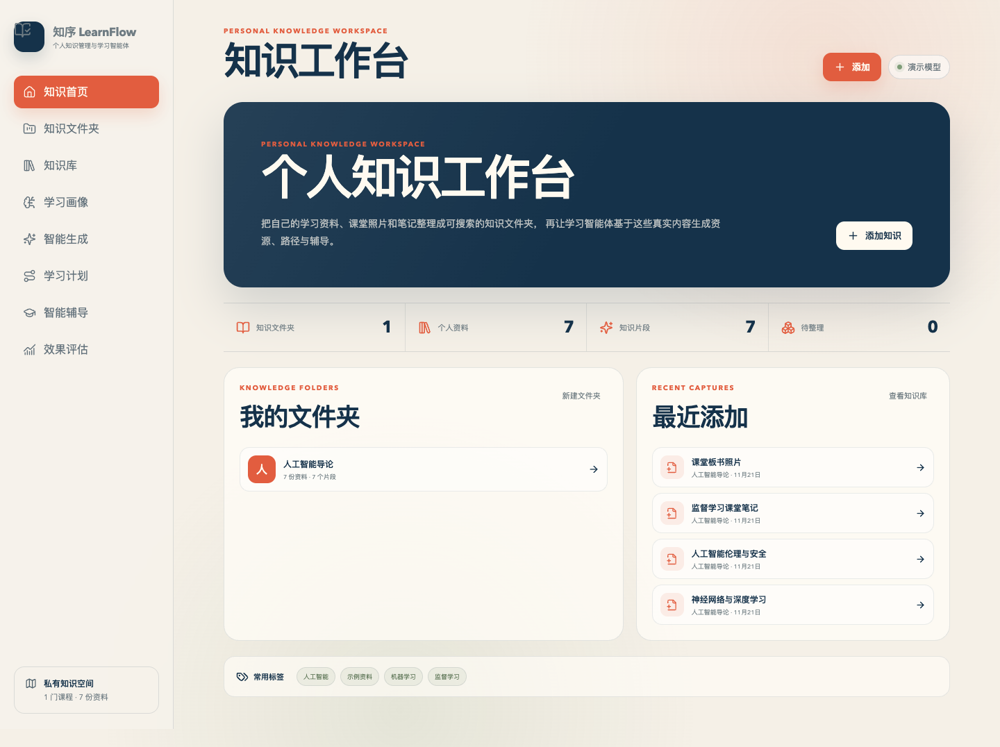
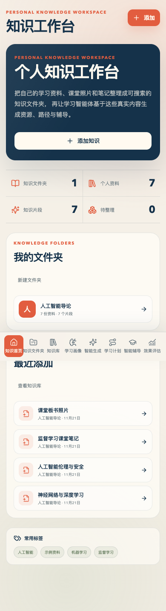
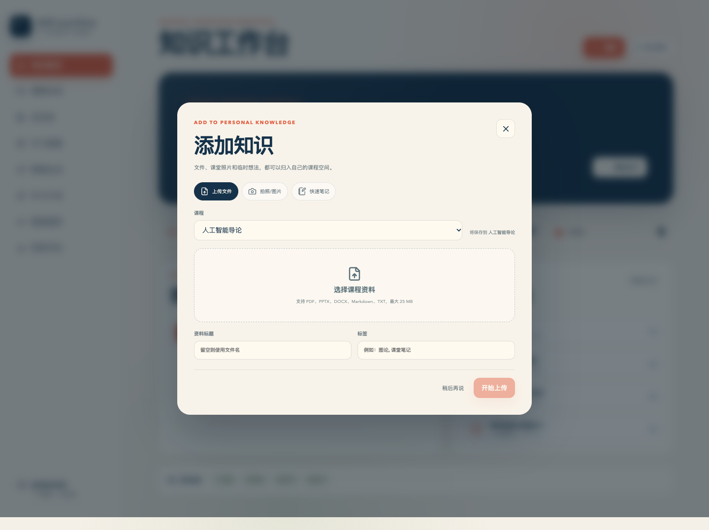
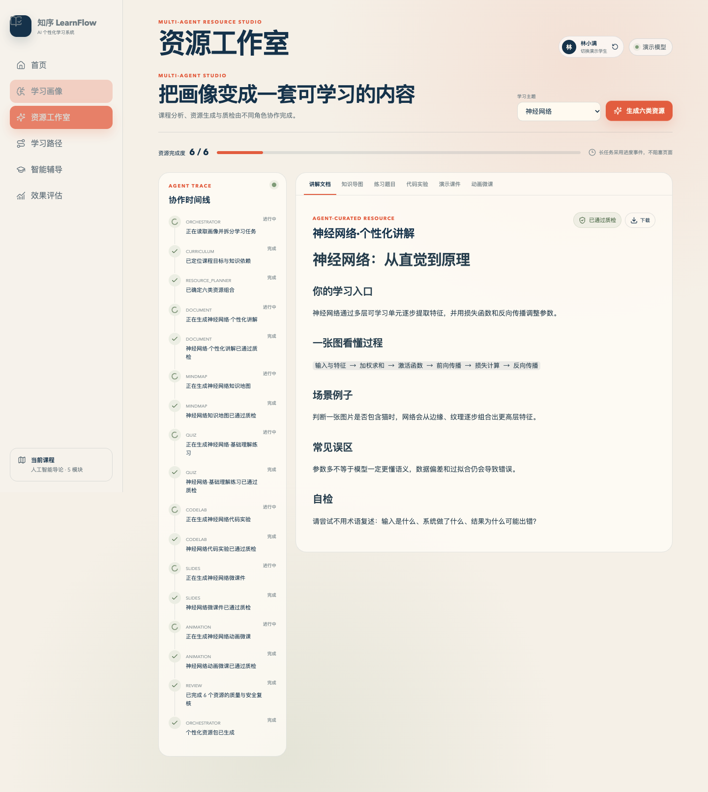

# 知序 LearnFlow

> 基于大模型的个性化资源生成与学习多智能体系统

知序 LearnFlow 是一个以**个人知识管理**为核心的智能学习 Web 应用。用户可以把课程资料、课堂照片、课堂笔记和学习通课程整理成自己的知识库，再通过八维学习画像和多智能体协作，获得讲解文档、思维导图、分层练习、代码实验、演示课件、动画微课、学习路径、有依据的辅导和效果评估。

项目面向第十五届“中国软件杯”大学生软件设计大赛 **A3 赛题**开发，同时以可真实运行、可部署、可审计的完整产品为交付目标。

## 在线体验

公网地址：

**<http://124.223.49.44/>**

当前服务器采用 HTTP。正式账号生产环境应配置域名、TLS 证书和自动续期。

## 项目截图

### 电脑端知识工作台



### 手机端响应式页面



### 资料、照片和笔记采集



### 多智能体资源工作台



## 目录

- [核心能力](#核心能力)
- [学习闭环](#学习闭环)
- [系统架构](#系统架构)
- [学习通连接器](#学习通连接器)
- [技术栈](#技术栈)
- [项目结构](#项目结构)
- [本地启动](#本地启动)
- [环境变量](#环境变量)
- [使用流程](#使用流程)
- [测试与质量门禁](#测试与质量门禁)
- [API 概览](#api-概览)
- [安全设计](#安全设计)
- [生产部署](#生产部署)
- [已知边界](#已知边界)
- [赛题文档](#赛题文档)
- [AI Coding 说明](#ai-coding-说明)

## 核心能力

### 1. 个人知识空间

- 每位用户拥有独立的个人工作空间。
- 可创建、重命名、打开和删除知识文件夹。
- 支持上传 PDF、PPTX、DOCX、Markdown、TXT 和图片。
- 支持手机拍照、相册和快速笔记。
- 自动提取正文；图片在 Tesseract 可用时执行中英文 OCR。
- 自动生成摘要、标签和可搜索知识片段。
- 支持跨课程搜索、来源追溯、资料详情和原始文件读取。
- 每位用户的工作空间默认包含 500 份资料和 500 MB 容量配额。

### 2. 学习通扫码导入

- 使用学习通 App 扫码授权，不要求用户向知序提供账号密码。
- 二维码 5 分钟失效，登录会话最多保留 24 小时。
- 学习通 Cookie 使用 AES-256-GCM 加密，不进入前端、日志或审计内容。
- 先预览课程和文件，再由用户选择课程及目标知识文件夹。
- 文档导入后自动生成知识片段并进入个人知识库。
- 视频不下载，只写入课程级“视频资料链接”笔记。
- 支持后台同步、进度轮询、取消、部分失败重试和断开连接。
- 同一外部资料通过学习通课程 ID、文件 ID 和 SHA-256 校验值去重。
- 支持 ZIP 资料包备用导入，不依赖在线学习通会话。

> 学习通没有面向本项目的公开 OAuth API，当前适配器依赖官方登录页和课程页面结构。上游改版时可通过功能开关关闭在线连接，并使用 ZIP 备用入口。

### 3. 对话式学习画像

画像包含八个维度：

1. 先修知识
2. 学习目标
3. 认知风格
4. 薄弱点
5. 资源偏好
6. 学习节奏
7. 编程基础
8. 兴趣方向

每个维度保存当前值、对话证据、置信度和更新时间。画像会随着学习对话、资源使用和评估结果动态更新。

### 4. 多智能体学习资源

一次资源运行由多个明确角色协作：

- 编排智能体
- 课程分析智能体
- 资源规划智能体
- 讲解文档智能体
- 思维导图智能体
- 分层练习智能体
- 代码实验智能体
- 演示课件智能体
- 动画微课智能体
- 质检智能体

系统一次可生成六类资源，并把来源课程、资料标题和知识点写入资源元数据。

### 5. 个性化学习支持

- **学习路径**：根据目标、基础和薄弱点重排学习节点。
- **智能辅导**：从个人课程知识片段检索证据，展示来源，无足够证据时拒答。
- **效果评估**：提交后测后计算掌握度并回写学习画像。
- **可重放进度**：智能体事件持久化到 SQLite，并通过 SSE 重放和实时推送。

### 6. 企业级账号与运维基线

- 邮箱注册、登录、登出和会话恢复。
- 密码使用带随机盐的 `scrypt` 哈希。
- 登录会话使用高熵 opaque token，数据库只保存 SHA-256 哈希。
- Cookie 使用 `HttpOnly`、`SameSite=Lax`，HTTPS 下启用 `Secure`。
- 多工作空间数据隔离，跨租户对象统一返回 404。
- 同源写请求校验、登录/注册限流、API 限流和审计日志。
- SQLite WAL、readiness、请求 ID 和每日自动备份。
- 单节点 systemd + Nginx 部署脚本。

## 学习闭环

```text
课程资料 / 照片 / 笔记
        ↓
个人知识库与知识片段
        ↓
对话式八维画像
        ↓
多智能体生成六类资源
        ↓
个性化学习路径
        ↓
有依据的智能辅导
        ↓
效果评估与掌握度回写
        └──────────────→ 更新画像和下一轮推荐
```

## 系统架构

```text
┌─────────────────────────────────────────────────────┐
│ React + TypeScript + Vite                           │
│ 知识工作台 / 知识文件夹 / 知识库 / 学习画像          │
│ 智能生成 / 学习路径 / 智能辅导 / 效果评估            │
└──────────────────────┬──────────────────────────────┘
                       │ REST + replayable SSE
┌──────────────────────▼──────────────────────────────┐
│ FastAPI API Layer                                   │
│ Auth / Workspace / Validation / SSE / Download       │
└───────┬──────────────┬──────────────────┬────────────┘
        │              │                  │
┌───────▼──────┐ ┌─────▼─────────┐ ┌──────▼──────────┐
│ Repository   │ │ LearningGraph │ │ KnowledgeBase   │
│ SQLite       │ │ Agent events  │ │ n-gram retrieval│
└──────────────┘ └─────┬─────────┘ └─────────────────┘
                       │
┌──────────────────────▼──────────────────────────────┐
│ Learning Connector                                  │
│ QR session / encrypted cookie vault / preview / job  │
│ document-only / video links / safe ZIP fallback      │
└──────────────────────┬──────────────────────────────┘
                       │
┌──────────────────────▼──────────────────────────────┐
│ Personal Knowledge Store                            │
│ Course / Asset / Note / Chunk / Search              │
│ PDF / Office / Markdown / TXT / Image OCR           │
└──────────────────────┬──────────────────────────────┘
                       │
        ┌──────────────┼──────────────────────┐
        ▼              ▼                      ▼
 ProfileAgent    ResourceBundle         Path/Assessment
 Curriculum      Document/MindMap       Safety
 Planner         Quiz/CodeLab           ModelGateway
 Review          Slides/Animation       Mock/Live
```

### 知识导入流水线

```text
文件或图片
  → 文件签名与 MIME 校验
  → 大小/页数/解压预算检查
  → 文本提取或 OCR
  → 知识片段切分
  → 摘要、标签和知识点
  → SQLite 持久化
  → 跨课程搜索与智能体检索
```

### 多智能体执行流水线

```text
用户主题与个人课程
  → 检索个人知识片段
  → 课程与资源规划
  → 六类资源并行/隔离生成
  → 质检与来源校验
  → SSE 事件和资源持久化
```

## 学习通连接器

### 用户流程

```text
知序登录用户
  → 生成一次性学习通二维码
  → 学习通 App 扫码确认
  → AES-GCM 加密短期 Cookie 会话
  → 预览课程和文件
  → 选择课程并设置文件夹映射
  → 持久化后台同步任务
  → 下载、校验、提取、去重和入库
```

### 安全边界

- 不实现账号密码登录，不保存学习通密码。
- 二维码与会话绑定知序用户；同一用户同时只能有一个扫码会话。
- 二维码 5 分钟失效；闲置扫码会话由后台自动清理。
- 连接会话最多 24 小时；过期、断开或异常时立即失效。
- 只允许 HTTPS 学习通官方域名和资料 CDN。
- 拒绝私网、回环、保留地址、IP 字面量、任意重定向和非白名单域名。
- 课程目录请求限制响应大小、页面数量和总截止时间。
- 在线文档单文件最大 100 MB。
- ZIP 最大上传 250 MB，解压总量最大 1 GB、最多 1,000 个文件。
- ZIP 拒绝路径穿越、绝对路径、反斜杠、符号链接、加密成员和嵌套压缩包。
- 断开学习通后，活动在线任务会停止，已导入资料继续保留。

## 技术栈

| 层级 | 技术 |
|---|---|
| 前端 | React 19、TypeScript、Vite、Lucide |
| 后端 | Python 3.11+、FastAPI、Pydantic、Uvicorn |
| 数据库 | SQLite WAL |
| 文档解析 | pypdf、python-docx、python-pptx、Pillow、Tesseract |
| 学习通连接 | HTTPX、AES-GCM、二维码会话、持久化导入任务 |
| 流式交互 | Server-Sent Events |
| 测试 | pytest、Vitest、Testing Library、Playwright |
| 部署 | systemd、Nginx、SQLite 在线备份 |
| 依赖管理 | uv、npm |

## 项目结构

```text
.
├── backend/
│   ├── app/
│   │   ├── auth.py                     # 账号、密码、会话和审计
│   │   ├── knowledge_store.py          # 课程、资料、片段与搜索
│   │   ├── ingestion.py                # 文本提取与 OCR
│   │   ├── chaoxing_adapter.py         # 学习通二维码与页面适配
│   │   ├── learning_service.py         # 学习通预览、映射和任务
│   │   ├── learning_worker.py          # 持久化后台导入执行器
│   │   ├── learning_api.py             # 学习通与 ZIP API
│   │   ├── zip_import.py               # 安全 ZIP 检查
│   │   ├── learning_graph.py           # 多智能体编排
│   │   ├── resource_agents.py          # 六类资源智能体
│   │   ├── profile_agent.py            # 八维画像
│   │   ├── path_agent.py               # 学习路径
│   │   ├── assessment_agent.py         # 评估与掌握度
│   │   ├── knowledge.py                # 有依据的课程检索
│   │   ├── safety.py                   # 输入安全与拒答
│   │   └── model_gateway.py            # Mock/OpenAI-compatible 适配
│   ├── data/knowledge/ai_intro/        # 示例课程知识库
│   ├── tests/                          # 后端测试
│   └── pyproject.toml
├── frontend/
│   ├── src/components/
│   │   ├── CaptureDialog.tsx           # 文件、拍照和笔记采集
│   │   ├── LearningConnectorDialog.tsx # 学习通扫码与导入向导
│   │   ├── ResourcePanel.tsx           # 六类资源预览
│   │   └── ...
│   ├── src/pages/                      # 知识、画像、资源、路径、辅导、评估
│   ├── tests/                          # Vitest 与 Testing Library
│   └── tests/e2e/                      # Playwright
├── deploy/                             # systemd、Nginx、备份和远程安装
├── docs/competition/                   # 赛题需求、架构、安全、测试和部署
├── docs/superpowers/                   # 规格与实施计划
├── scripts/                            # 开发、测试、打包和远程部署
└── .env.example
```

## 本地启动

### 环境要求

- Python 3.11+
- Node.js 20.19+
- npm
- uv
- Google Chrome（Playwright 端到端测试）
- Tesseract 与中文语言包（可选，用于图片 OCR）

### 1. 安装后端

```bash
cd backend
uv sync --group dev
cd ..
```

### 2. 安装前端

```bash
cd frontend
npm ci
cd ..
```

### 3. 启动完整开发环境

```bash
./scripts/dev.sh
```

默认地址：

- Web：<http://127.0.0.1:5173>
- API：<http://127.0.0.1:8000/api/health>

也可以使用环境变量修改本地端口：

```bash
LEARNFLOW_API_PORT=8100 LEARNFLOW_WEB_PORT=5200 ./scripts/dev.sh
```

## 环境变量

复制 `.env.example` 并只在可信环境中设置真实值。**禁止把真实密钥写入前端或提交到 Git。**

| 变量 | 默认值 | 说明 |
|---|---|---|
| `LEARNFLOW_DATA_DIR` | `backend/data/runtime` | SQLite 和上传文件目录 |
| `LEARNFLOW_MODEL_API_KEY` | 空 | OpenAI-compatible API Key；为空时使用 Mock |
| `LEARNFLOW_MODEL_BASE_URL` | 空 | 兼容模型服务地址 |
| `LEARNFLOW_MODEL_NAME` | 空 | 模型名称 |
| `LEARNFLOW_CHAOXING_ENABLED` | `false` | 是否启用学习通在线连接器 |
| `LEARNFLOW_CONNECTOR_KEY` | 空 | 学习通 Cookie AES-256-GCM 主密钥 |
| `LEARNFLOW_ALLOWED_ORIGINS` | 空 | 额外允许的跨域前端 Origin |
| `LEARNFLOW_API_PORT` | `8000` | 本地 API 端口 |
| `LEARNFLOW_WEB_PORT` | `5173` | 本地前端端口 |
| `VITE_API_BASE_URL` | 同源 `/api` | 前端显式 API 地址，通常无需设置 |

### 启用兼容模型

```bash
export LEARNFLOW_MODEL_API_KEY='replace-with-your-key'
export LEARNFLOW_MODEL_BASE_URL='https://your-openai-compatible-endpoint.example/v1'
export LEARNFLOW_MODEL_NAME='your-model-name'
./scripts/dev.sh
```

没有模型密钥时，系统自动使用确定性 Mock 模式，所有页面和测试仍可运行。

### 启用学习通连接器

```bash
export LEARNFLOW_CHAOXING_ENABLED=true
export LEARNFLOW_CONNECTOR_KEY="$(openssl rand -base64 32)"
```

`LEARNFLOW_CONNECTOR_KEY` 必须是 32 字节随机值。更换密钥会使已有学习通会话失效，但不会删除已经导入的资料。

## 使用流程

### 首次使用

1. 打开 Web 页面并注册个人账号。
2. 系统自动建立独立工作空间和初始知识文件夹。
3. 在“知识文件夹”中创建自己的课程文件夹。

### 添加个人资料

1. 点击顶部“添加”或页面中的“添加知识”。
2. 选择“上传文件”“拍照/图片”或“快速笔记”。
3. 选择目标课程文件夹。
4. 保存后等待文本提取和知识片段生成。
5. 在“知识库”中搜索正文、标题、标签和知识点。

### 导入学习通课程

1. 登录知序账号并进入“知识文件夹”。
2. 点击“连接学习通”。
3. 使用学习通 App 扫描二维码并确认。
4. 选择要读取的课程资料。
5. 为课程选择“新建文件夹”“合并到已有文件夹”或“暂不导入”。
6. 确认后在后台同步，完成后可在知识库搜索。

### 使用学习智能体

1. 在“学习画像”中完成自然语言对话。
2. 进入“智能生成”，选择个人课程和主题。
3. 等待资源规划、六类资源生成和质检。
4. 查看资源来源并下载所需资源。
5. 继续使用“学习计划”“智能辅导”和“效果评估”形成学习闭环。

## 测试与质量门禁

运行全部检查：

```bash
./scripts/test-all.sh
```

单独运行：

```bash
# 后端
cd backend
uv run pytest -v
uvx ruff check app tests
uvx pip-audit --path .venv

# 前端
cd ../frontend
npm test -- --run
npm run build
npm audit
npm run test:e2e
```

当前结果：

| 检查 | 结果 |
|---|---|
| 后端 pytest | 113 passed |
| 后端 Ruff | 通过 |
| 前端 Vitest | 59 passed |
| TypeScript + Vite 构建 | 通过 |
| Playwright 桌面/手机流程 | 5 passed |
| Python 依赖审计 | 未发现已知漏洞 |
| npm 依赖审计 | 0 vulnerabilities |

测试覆盖包括：

- 认证、Cookie、跨租户隔离、跨站写入拒绝和限流。
- 知识文件夹、资料上传、知识提取、搜索和来源详情。
- 八维画像、六类资源、路径、辅导和评估闭环。
- 学习通二维码状态、加密会话、并发扫码竞态和会话清理。
- 学习通课程预览、映射、后台下载、失败重试、断连停止和重启恢复。
- ZIP 路径穿越、符号链接、加密成员、嵌套压缩包和容量限制。
- 桌面与手机扫码导入向导，以及所有关键按钮的加载/成功/失败反馈。

## API 概览

### 账号

```text
POST /api/auth/register
POST /api/auth/login
POST /api/auth/logout
GET  /api/auth/me
```

### 个人知识库

```text
GET    /api/knowledge/overview
GET    /api/knowledge/search
GET    /api/courses
POST   /api/courses
PATCH  /api/courses/{course_id}
DELETE /api/courses/{course_id}
GET    /api/courses/{course_id}/assets
POST   /api/courses/{course_id}/assets
POST   /api/courses/{course_id}/notes
GET    /api/assets/{asset_id}
GET    /api/assets/{asset_id}/file
DELETE /api/assets/{asset_id}
```

### 学习通连接

```text
GET    /api/learning/chaoxing/status
POST   /api/learning/chaoxing/login
GET    /api/learning/chaoxing/login/{login_id}
GET    /api/learning/chaoxing/login/{login_id}/qr
POST   /api/learning/chaoxing/login/{login_id}/refresh
DELETE /api/learning/chaoxing/login/{login_id}
DELETE /api/learning/chaoxing/connection
POST   /api/learning/chaoxing/previews
POST   /api/learning/imports/zip/previews
POST   /api/learning/imports
GET    /api/learning/imports/{job_id}
GET    /api/learning/imports/{job_id}/items
POST   /api/learning/imports/{job_id}/cancel
POST   /api/learning/imports/{job_id}/retry
```

### 学习智能体

```text
GET  /api/personas
POST /api/learners
POST /api/learners/{learner_id}/profile/chat
POST /api/learners/{learner_id}/runs
GET  /api/runs/{run_id}
GET  /api/runs/{run_id}/stream
POST /api/learners/{learner_id}/paths
POST /api/learners/{learner_id}/tutor
GET  /api/assessments/questions
POST /api/learners/{learner_id}/assessments
GET  /api/resources/{resource_id}/download
```

### 健康检查

```text
GET /api/health
GET /api/health/live
GET /api/health/ready
```

## 安全设计

### 身份与租户隔离

- 客户端不能指定工作空间，工作空间由服务端会话推导。
- 课程、资料、知识点、学习者、运行、资源、评估、学习通连接和导入任务都带工作空间条件。
- 跨租户对象统一返回 404。
- 密码使用 `scrypt`；会话 Token 只保存哈希。
- 写操作校验 Origin；登录、注册、连接和导入分别限流。
- 关键操作写入审计表。

### 文件安全

- 服务端检查扩展名、文件大小、真实 MIME、图片像素和 Office ZIP 结构。
- 原始文件保存在私有数据目录，不使用客户端提供的路径。
- 图片内联预览；其他原始文件强制下载。
- ZIP 不直接解压到知识目录，而是先做成员、路径、符号链接、嵌套压缩包和体积检查。

### 学习通安全

- 不请求、不保存学习通账号密码。
- 会话 Cookie 使用 AES-256-GCM 加密。
- 二维码 5 分钟失效，连接会话最多 24 小时。
- 所有上游 URL 先做 HTTPS、域名、IP 和重定向白名单校验。
- 课程请求有响应体积、页面预算和总时限。
- 断开连接后清除会话，并让活动在线任务停止继续访问上游。

更完整的安全说明见：

- [安全与生产基线](docs/competition/security.md)
- [学习通连接设计规格](docs/superpowers/specs/2026-11-22-chaoxing-learning-platform-connector-design.md)

## 生产部署

服务器已使用以下架构：

- Ubuntu + systemd
- Nginx 反向代理
- FastAPI 单进程
- SQLite WAL
- `/var/lib/learnflow/` 持久数据
- `/var/backups/learnflow/` 每日在线备份
- `/opt/learnflow/releases/<timestamp>` 版本目录
- `/opt/learnflow/current` 当前版本符号链接

远程部署：

```bash
DEPLOY_HOST=124.223.49.44 \
DEPLOY_USER=ubuntu \
DEPLOY_SSH_KEY="$HOME/.ssh/id_ed25519" \
./scripts/deploy-remote.sh
```

完整部署、备份、回滚和学习通密钥配置见：

- [部署手册](docs/competition/deployment.md)
- [运维说明](deploy/README.md)

## 已知边界

- 当前生产为单机 SQLite，不适合多节点横向扩展。
- 后台学习通任务运行在 API 单进程内，尚未拆分独立队列 worker。
- 登录限流为单进程内存实现，多 worker 时应迁移到 Redis。
- 尚未实现邮箱验证、找回密码、密码修改、MFA 和恶意文件病毒扫描。
- 公网当前使用 HTTP；密码服务正式上线前必须配置 HTTPS 和域名。
- 学习通页面结构变化可能导致适配器暂停，可关闭在线连接并使用 ZIP 备用导入。
- 真实学习通账号目录需要在部署后由账号本人扫码验收，自动化测试不使用真实账号。
- 向量检索、对象存储和大视频转写属于后续扩展。

## 赛题文档

- [赛题需求映射](docs/competition/requirements.md)
- [系统架构说明](docs/competition/architecture.md)
- [测试报告](docs/competition/test-report.md)
- [安全与生产基线](docs/competition/security.md)
- [部署手册](docs/competition/deployment.md)
- [第三方许可证](docs/competition/third-party-licenses.md)
- [7 分钟演示视频脚本](docs/competition/demo-video-script.md)
- [AI Coding 工具说明](docs/competition/ai-coding-statement.md)
- [个性化学习多智能体设计规格](docs/superpowers/specs/2026-11-20-a3-personalized-learning-multi-agent-design.md)
- [个人知识工作台设计规格](docs/superpowers/specs/2026-11-21-personal-knowledge-workspace-design.md)
- [学习通连接设计规格](docs/superpowers/specs/2026-11-22-chaoxing-learning-platform-connector-design.md)

## AI Coding 说明

项目开发使用了 AI Coding 工具辅助需求拆解、代码实现、测试生成、架构审查、文档整理和部署检查。所有模型生成内容均经过以下人工/自动化复核：

- 代码审查与静态分析
- 单元、组件、API 与浏览器测试
- 依赖漏洞审计
- 密钥与敏感信息扫描
- 数据库完整性和备份验证
- 公网 readiness 与服务状态检查

AI 工具不替代对课程事实、资料版权、账号权限和生产安全边界的人工确认。

## 仓库

AtomGit：

**<https://atomgit.com/zl2222/study>**

公开仓库不包含真实用户数据库、学习通 Cookie、模型 API Key、连接器主密钥或服务器环境文件。
